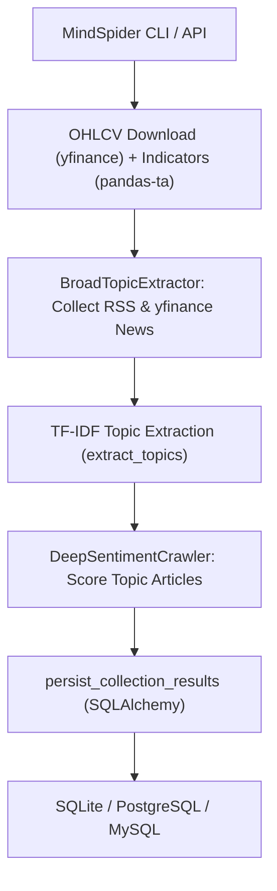

# MindSpider

> Market data, financial news extraction, topic clustering, and sentiment persistence subsystem for **Trend Pulse** by [Corax CoLAB](https://coraxcolab.com) & [Pelle](https://github.com/PelleNybe).

---

## Overview

**MindSpider** collects market OHLCV series, computes technical indicators, gathers financial headlines from `yfinance` and RSS feeds, extracts salient daily topics using TF-IDF weighting, runs financial sentiment analysis across matched articles, and persists structured records via SQLAlchemy.



---

## Directory Structure

```
MindSpider/
├── BroadTopicExtraction/
│   └── __init__.py          # BroadTopicExtractor & DEFAULT_FINANCIAL_RSS_FEEDS
├── DeepSentimentCrawling/
│   └── __init__.py          # DeepSentimentCrawler topic-level sentiment scorer
├── schema/
│   ├── __init__.py
│   ├── init_database.py     # Async/sync schema and SQL view initializer
│   ├── db_manager.py        # Database inspection, statistics, and cleanup CLI
│   ├── models_sa.py         # Core SQLAlchemy ORM models (daily_news, daily_topics, etc.)
│   └── models_bigdata.py    # Extended social platform ORM models
├── config.py.example        # Example database configuration
├── main.py                  # Main collector CLI and library entrypoints
├── requirements.txt
└── README.md
```

---

## Database Schema

### Core Tables (`schema/models_sa.py`)
1. **`daily_news`** — Deduplicated financial headlines, URLs, descriptions, source platforms, and rank positions.
2. **`daily_topics`** — Daily extracted topics (`topic_id`, `topic_name`, `keywords`, `relevance_score`, `news_count`).
3. **`topic_news_relation`** — Many-to-many relevance links between topics and news records.
4. **`crawling_tasks`** — Execution status, item counts, timing, and sentiment metrics per topic task.

### Extended Platform Models (`schema/models_bigdata.py`)
Additional SQLAlchemy models exist for archived/extended platform datasets (`youtube_video`, `tiktok_aweme`, `instagram_note`, `twitter_note`, `reddit_note`, `hackernews_content`, `youtubeshorts_video`).

---

## Setup & Configuration

MindSpider reads database and model configuration from the repository root `.env` / `config.py` (generated via `python generate_config.py`). By default, if `DATABASE_URL` is omitted and `DB_DIALECT=sqlite`, MindSpider stores data locally in `MindSpider/mindspider.db`.

Example `.env` settings for PostgreSQL or SQLite:

```env
# SQLite (zero external services required)
DB_DIALECT=sqlite
DB_NAME=mindspider.db

# Or PostgreSQL / MySQL
# DB_DIALECT=postgresql
# DB_HOST=localhost
# DB_PORT=5432
# DB_USER=trendpulse
# DB_PASSWORD=your_password
# DB_NAME=mindspider
```

Initialize tables and summary views directly if needed:

```bash
python MindSpider/schema/init_database.py
```

---

## CLI Usage

Run commands from the repository root (with `.venv` activated):

```bash
# Collect 1-year OHLCV + indicators + RSS/yfinance news, topics, and sentiment for SPY
python MindSpider/main.py --ticker SPY

# Fetch full historical OHLCV dataset (--complete) for NVDA
python MindSpider/main.py --ticker NVDA --complete

# Use an explicit SQLAlchemy database URL
python MindSpider/main.py --ticker AAPL --db-url sqlite:///./mindspider.db

# Show database tables and row statistics
python MindSpider/main.py --status
```

### Supported CLI Arguments (`MindSpider/main.py`)
- `--ticker` (default: `SPY`) — Ticker symbol to analyze and collect
- `--complete` — Download full historical OHLCV range (`period="max"` instead of `"1y"`)
- `--broad-topic` — Flag for broad daily financial topic extraction workflow
- `--deep-sentiment` — Flag for deep topic sentiment analysis workflow
- `--status` — Print database tables and summary statistics via `DatabaseManager`
- `--db-url` — Override synchronous SQLAlchemy connection string

### Database Management CLI (`MindSpider/schema/db_manager.py`)

```bash
python MindSpider/schema/db_manager.py --tables
python MindSpider/schema/db_manager.py --stats
```

---

## Python API

```python
from MindSpider.BroadTopicExtraction import BroadTopicExtractor
from MindSpider.DeepSentimentCrawling import DeepSentimentCrawler
from MindSpider.main import fetch_financial_data, persist_collection_results

# End-to-end collection pipeline
summary = fetch_financial_data(ticker="SPY", complete=False, db_url="sqlite:///mindspider.db")

# Or call components individually
extractor = BroadTopicExtractor()
news_items = extractor.collect_news(ticker="SPY", max_items=25)
topics = extractor.extract_topics(news_items, max_topics=5)

crawler = DeepSentimentCrawler()
crawl_tasks = crawler.analyze_topics_sentiment(topics, news_items)
counts = persist_collection_results("sqlite:///mindspider.db", "SPY", news_items, topics, crawl_tasks)
```
