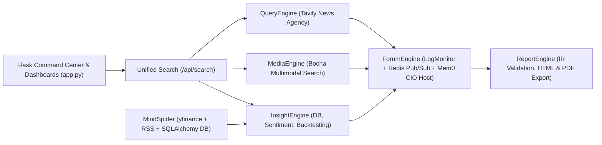

# Trend Pulse

<div align="center">
  <h3>Next-Gen Multi-Agent Financial Market Analysis Platform</h3>
  <p>
    Engineered by <a href="https://coraxcolab.com"><strong>Corax CoLAB</strong></a> |
    Developer: <a href="https://github.com/PelleNybe"><strong>Pelle</strong></a>
  </p>
  <p>
    <a href="https://coraxcolab.com"></a>
    <a href="https://github.com/PelleNybe"></a>
    <a href="https://buymeacoffee.com/pellenybe"></a>
    <a href="LICENSE"></a>
  </p>
</div>

---

## Overview

**Trend Pulse** is a hybrid multi-agent financial intelligence and market analysis platform. It coordinates specialized LLM research engines, quantitative indicator pipelines, event-driven agent debates, financial news/topic crawlers, and interactive web dashboards into a unified command center.



### Multi-Agent & Data Modules

- **InsightEngine (`InsightEngine/`):** Financial database queries (`TrendPulseDB`), quantitative technical indicators (`pandas-ta`), portfolio optimization & backtesting (`PortfolioOptimizer`, `PortfolioBacktester`), multi-signal financial sentiment scoring (`FinancialSentimentAnalyzer`), and TF-IDF / embedding clustering.
- **QueryEngine (`QueryEngine/`):** Targeted news and web intelligence via `TavilyNewsAgency` with iterative reflection loops.
- **MediaEngine (`MediaEngine/`):** Multimodal web and media intelligence via `BochaMultimodalSearch`.
- **ForumEngine (`ForumEngine/`):** Watches engine logs (`LogMonitor`), moderates structured inter-agent debates via `FinancialCommitteeHost` (`Mem0` long-term memory + LLM directives), and streams events over Redis Pub/Sub.
- **ReportEngine (`ReportEngine/`):** Structured intermediate-representation (`IR`) validation, chart/table validation & repair, interactive HTML hydration, and Markdown/PDF report rendering.
- **MindSpider (`MindSpider/`):** Fetches OHLCV data (`yfinance`), calculates technical indicators, extracts daily market topics from RSS/yfinance feeds, scores topic sentiment, and persists structured tables via SQLAlchemy (`SQLite`, `PostgreSQL`, or `MySQL`).

---

## Real-Time Dashboards & API Routes

The Flask application (`app.py`) serves the unified command center (`/`) together with dedicated analytical views and JSON APIs (protected by `@admin_required` via `X-API-Key` when `ADMIN_API_KEY` is configured):

### Web Views
- `/` — Unified Command Center, engine process manager, live WebSocket logs, Forum debate viewer, and configuration modal
- `/geo` — Global market geo-pulse (`templates/geo_pulse.html`)
- `/heat` — Asset correlation heat-link matrix (`templates/heat_link.html`)
- `/mem0` — Agentic memory explorer and forum injection (`templates/mem0_explorer.html`)
- `/oracle` — Probability tree & backtest scenario simulator (`templates/oracle_paths.html`)
- `/nexus` — Multi-agent Nexus debate visualizer (`templates/nexus_map.html`)
- `/omnifeed` — Unified live market ticker, feed, and geo stream (`templates/omni_feed.html`)
- `/swarm` — Multi-agent swarm status and orchestration view (`templates/swarm_matrix.html`)
- `/ta_matrix` — Live Technical Analysis matrix (`templates/ta_matrix.html`)
- `/portfolio_optimizer` — Markowitz / risk-adjusted portfolio optimizer (`templates/portfolio_optimizer.html`)
- `/anomaly_radar` — Volume/price anomaly detection view (`templates/anomaly_radar.html`)
- `/news_feed` — Financial RSS feed & sentiment viewer (`templates/news_feed.html`)
- `/stress_matrix` — Rolling correlation stress matrix (`templates/stress_matrix.html`)

### Core API Endpoints
- `GET /api/health` — Container health, uptime, and `ReportEngine` availability
- `GET /api/status` & `GET /api/system/status` — Engine statuses and CPU/memory metrics (`insight`, `media`, `query`, `report`, `forum`)
- `GET /api/start/<app_name>` & `GET /api/stop/<app_name>` — Start or stop individual engine workers
- `POST /api/system/start` & `POST /api/system/shutdown` — Coordinated startup and shutdown
- `POST /api/search` & `GET /api/search/suggest` — Concurrent multi-engine search and ticker/topic autocomplete
- `GET/POST /api/config` — Read and update `.env` / runtime configuration
- `GET /api/forum/log`, `GET /api/forum/export`, `GET /api/nexus/debate` — Forum debate logs and synthesis
- `GET /api/mem0/memories` & `POST /api/mem0/feed` — Query and inject long-term agent memories
- `GET /api/oracle/paths` & `POST /api/oracle/simulate` — Live path probabilities and backtest simulations
- `GET /api/market_tickers`, `/api/ta_matrix_data`, `/api/correlation_data`, `/api/stress_matrix_data`, `/api/portfolio_data`, `/api/anomaly_data`, `/api/geo_data`, `/api/news_data` — Live market analytics feeds

---

## Getting Started

### 1. Prerequisites
- **Python 3.12+** (tested on Python 3.12 with `.venv`)
- **Node.js 20+** (for frontend script syntax verification)
- Optional services: **Redis** (token tracking & Pub/Sub), **PostgreSQL** or **MySQL** (or local **SQLite** for MindSpider)

### 2. Installation & Configuration

```bash
# Clone the repository
git clone https://github.com/PelleNybe/Trend-Pulse.git
cd Trend-Pulse

# Create and activate a virtual environment
python3 -m venv .venv
source .venv/bin/activate  # On Windows: .venv\Scripts\activate

# Install Python dependencies
pip install -r requirements.txt

# Copy environment template and configure keys (including SECRET_KEY)
cp .env.example .env
# Edit .env to set SECRET_KEY, optional ADMIN_API_KEY, and LLM/search API keys

# Generate typed Pydantic v2 configuration (config.py)
python generate_config.py
```

> **PDF Export Dependencies:** Exporting reports to PDF with WeasyPrint requires system Pango/Cairo libraries. See [static/Partial README for PDF Exporting/README.md](static/Partial%20README%20for%20PDF%20Exporting/README.md) for OS-specific installation steps and verify with `python -m ReportEngine.utils.dependency_check`.

### 3. Running the Application

Start directly with Python or via the startup helper script:

```bash
# Recommended startup script (ensures .env, config.py, and SECRET_KEY are loaded)
./start_app.sh

# Or run directly in the foreground (requires SECRET_KEY in environment or .env)
python app.py
```

Open `http://localhost:5000` to access the dashboard.

To run MindSpider data collection and persistence:

```bash
# Collect OHLCV data, extract daily market topics, score sentiment, and store in DB
python MindSpider/main.py --ticker SPY --complete

# Inspect database tables and row counts
python MindSpider/main.py --status
```

### 4. Containerized Deployment

```bash
docker compose up -d
```

Kubernetes manifests are available under [`k8s/`](k8s/).

---

## Testing & CI

Run the full test suite and checks locally:

```bash
# Run pytest suite across core app, engines, forum, MindSpider, and ReportEngine
SECRET_KEY=local-test-secret pytest -v tests/ ReportEngine/utils/test_chart_validator.py ReportEngine/utils/test_json_parser.py

# Run standalone ForumEngine monitor test runner
python tests/run_tests.py

# Bytecode compile check
python -m compileall -q app.py generate_config.py InsightEngine MediaEngine QueryEngine ReportEngine ForumEngine MindSpider utils tests
```

Continuous integration runs automatically on pushes and pull requests via [`.github/workflows/ci.yml`](.github/workflows/ci.yml).

---

## Support, Credits & Sponsorship

- **Organization:** [Corax CoLAB](https://coraxcolab.com)
- **Developer:** [Pelle](https://github.com/PelleNybe)
- **Sponsor:** If you find Trend Pulse useful, consider supporting development via [Buy Me a Coffee](https://buymeacoffee.com/pellenybe) ☕
- See [`SECURITY.md`](SECURITY.md) for vulnerability reporting guidelines.
- See [`CONTRIBUTING.md`](CONTRIBUTING.md) and [`CODE_OF_CONDUCT.md`](CODE_OF_CONDUCT.md) before opening pull requests.
- See [`SUPPORT.md`](SUPPORT.md) for support channels and [`CHANGELOG.md`](CHANGELOG.md) for release notes.

---

## Disclaimer & License

<div align="center">
  <strong>Intended for financial research, education, and software development workflows.</strong>
  <br>
  Verify all market data and comply with data provider terms of service and <code>robots.txt</code>.
  Provided "as is" without warranties or investment advice.
</div>

Distributed under the **MIT License** (see [`LICENSE`](LICENSE)). Copyright (c) 2023-2026 [Corax CoLAB](https://coraxcolab.com) & [Pelle](https://github.com/PelleNybe).
